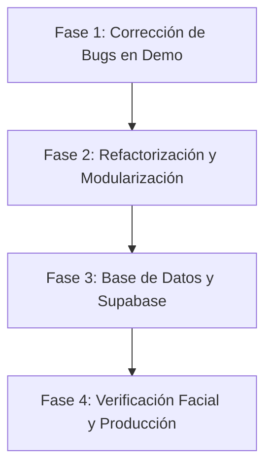

# Diagnóstico y Análisis Técnico: Proyecto `checadorTest`

Este documento contiene el análisis exhaustivo del código, arquitectura, estilos CSS, manejo de estado y persistencia del proyecto **Checador Web**, detallando las causas de los comportamientos anómalos (como el bloqueo tras 24 horas) y una hoja de ruta con mejoras prioritarias.

---

## 1. Estado de Ejecución del Proyecto

* **Servidor de desarrollo:** Vite v8.x ejecutándose en segundo plano (`http://localhost:5173/`).
* **Instalación:** Dependencias instaladas limpiamente (`npm install`, 31 paquetes).
* **Compilación y tipado:** React 19 + TypeScript + Vite.

---

## 2. Diagnóstico: ¿Cómo y dónde se guardan los datos? ¿Por qué no se desbloquea tras 24 horas?

### 2.1 ¿En RAM o Supabase?
Actualmente, **en el modo sin cuenta (Demostración), los datos NO se guardan en Supabase ni únicamente en la RAM**. 
* Se persisten en el **`localStorage` del navegador** bajo la clave:
  ```ts
  const KEY = 'checador.web.demo.attendance.v2';
  ```
  *(Ubicado en `src/features/attendance/demoRecords.ts`)*.
* Si el usuario inicia sesión real con Supabase:
  * Supabase **solo está cableado para autenticación y lectura** de RPCs (`get_active_site` y `get_visible_asistencias`).
  * **La escritura real está deliberadamente bloqueada en el código:**
    ```ts
    // App.tsx: Línea 27
    if (!demo) {
      setError('Foto capturada. La asistencia de una cuenta real aún requiere integrar el descriptor facial compatible con el backend; no se envió ningún registro.');
      return;
    }
    ```
    Por lo tanto, en cuenta real **nunca se envía ni guarda ninguna asistencia**.

### 2.2 El Bug de las 24 horas (Por qué no se desbloquea el estado)
El bloqueo infinito del botón de entrada ocurre por cómo se diseñó la lógica en `src/features/attendance/demoRecords.ts` y `src/App.tsx`:

1. **Uso de etiquetas fijas en vez de marcas de tiempo (`timestamps`):**
   * Cuando se registra una entrada, se guarda el campo `day` con el string literal `'Hoy'`:
     ```ts
     const next = [{ id: crypto.randomUUID(), day: 'Hoy', entry, exit: '—', ... }];
     ```
   * En `App.tsx`:
     ```ts
     const todayRow = rows.find(row => row.day === 'Hoy' || new Date(row.day).toDateString() === new Date().toDateString());
     ```
   * En `demoRecords.ts`:
     ```ts
     if (records.some(r => r.day === 'Hoy' && r.entry !== '—')) {
       return { records, error: 'Ya hay una entrada de prueba para hoy.' };
     }
     ```
2. **La causa exacta del defecto:**
   * El registro guardado **nunca cambia su valor `day: 'Hoy'`** al pasar los días porque es una cadena estática escrita en el disco local (`localStorage`).
   * Pasen 24 horas, 3 días o 1 mes, cuando el usuario abre la aplicación, el array sigue teniendo un objeto con `day === 'Hoy'`.
   * El código evalúa `todayRow.entry !== '—'` y deshabilita permanentemente el botón **Registrar entrada**:
     ```tsx
     <button disabled={!!todayRow?.entry && todayRow.entry !== '—'}>
     ```
   * No existe ningún mecanismo que compare la fecha del sistema (`YYYY-MM-DD`) con la fecha real en que se creó el registro para archivar el día anterior como `Ayer` o fecha histórica.

---

## 3. Análisis de CSS y Estilos

* **¿Usa Frameworks de CSS?**
  * **No.** No utiliza TailwindCSS, Bootstrap, ni bibliotecas de componentes como MUI o Chakra.
  * Utiliza **CSS Vanilla puro** centralizado en un único archivo: `src/styles.css` (15 KB).
* **Calidad y aspectos positivos:**
  * Define variables CSS nativas (`:root { --primary, --accent, --soft, --line, ... }`).
  * Usa tipografías modernas de Google Fonts (`Manrope` y `DM Sans`).
  * Implementa un diseño responsivo con breakpoints en `850px` (colapso de sidebar) y `600px` (barra de navegación inferior móvil).
  * Incluye efectos visuales pulidos: backdrop-filter en modales, gradientes lineales y micro-interacciones.
* **Defectos detectados en el CSS:**
  * **Todo está minificado/comprimido en una sola línea** en el repositorio original, lo que dificulta enormemente el mantenimiento y la lectura.
  * **Falta de modularidad:** No usa CSS Modules ni metodologías como BEM. Clases como `.content`, `.primary`, `.avatar` están en el ámbito global con riesgo de colisión.
  * **Responsividad del Header en móviles:** En pantallas menores a 600px, el header oculta nombres y botones de forma abrupta.
  * **Accesibilidad:** Varios textos y etiquetas pequeñas (`font-size: 8px` y `9px`) violan las directrices mínimas de legibilidad y contraste WCAG.

---

## 4. Análisis de Arquitectura y Código

* **Estructura de Directorios:**
  * Buena separación inicial por dominios:
    * `src/features/attendance`: Captura de cámara y registros demo.
    * `src/features/auth`: Página de login.
    * `src/features/history`: Tabla de asistencias.
    * `src/components`: Componentes reutilizables.
    * `src/lib`: Cliente Supabase.
* **Problemas de Arquitectura:**
  1. **Monolito en `App.tsx`:**
     * `App.tsx` concentra el reloj en vivo, el estado de sesión, la carga RPC, el enrutamiento (`view`), la lógica de cámara y el renderizado completo de las tres vistas (Jornada, Historial, Perfil) en más de 8 KB de archivo sin modularizar.
  2. **Sin Enrutador Oficial:**
     * El cambio de páginas se hace con un `useState<'home'|'history'|'profile'>`. No hay URLs reales ni historial del navegador (`react-router` o TanStack Router ausentes).
  3. **Tipado `any` en llamadas a Supabase:**
     * `r: any` en el mapeo de registros RPC; no hay esquemas tipados con TypeScript para la base de datos.
  4. **Captura de Cámara:**
     * Bien resuelta con la API nativa de `navigator.mediaDevices.getUserMedia` y renderizado a `HTMLCanvasElement`, pero genera strings en Base64 muy pesados que saturan la memoria si se almacenan repetidamente.

---

## 5. Mejoras Recomendadas

### 5.1 Persistencia y Fechas (Urgente)
1. **Sustituir `day: 'Hoy'` por fechas ISO 8601:**
   * Guardar `date: '2026-10-14'` y `timestamp: 1776180000000`.
   * Al iniciar la app, calcular dinámicamente si el registro corresponde a la fecha de hoy:
     ```ts
     const isToday = record.date === new Date().toISOString().split('T')[0];
     ```
   * Si el último registro es de ayer o días previos, el estado del día actual inicia limpio automáticamente.
2. **Cierre de Jornadas no finalizadas:**
   * Si un usuario registró entrada pero nunca registró salida y pasaron más de 16 horas, marcar la jornada como "Incompleta / Sin salida" para permitir registrar la entrada del nuevo día.

### 5.2 Integración Real con Supabase
1. **Crear las tablas y migraciones:**
   * Tabla `asistencias` (`id`, `user_id`, `site_id`, `check_in`, `check_out`, `face_verified`, `created_at`).
   * Configurar políticas RLS para que los usuarios solo inserten y lean sus propios registros.
2. **Generar tipos de base de datos:**
   * Utilizar `supabase gen types typescript` para tener tipado estricto en lugar de `any`.
3. **Módulo de Reconocimiento Facial:**
   * Integrar librerías como `@vladmandic/face-api` o MediaPipe FaceMesh en el cliente web para extraer los descriptores (vectores de 128 o 512 dimensiones) antes de enviar la confirmación a Supabase.

### 5.3 Estructura del Frontend
1. **Modularizar `App.tsx`:**
   * Separar `HomeView.tsx`, `HistoryView.tsx` y `ProfileView.tsx` en sus propios componentes.
2. **Formatear y Modularizar CSS:**
   * Descomprimir `styles.css` en módulos (`login.css`, `attendance.css`, `shell.css`) o adoptar CSS Modules.
3. **Gestión de Estado:**
   * Migrar la lógica de asistencia a un hook personalizado (`useAttendance.ts`) o Zustand para separar la lógica de negocio de la UI.

---

## 6. Setlist de Pasos a Seguir (Roadmap)



### Paso 1: Corregir el bug del bloqueo de 24h
- [ ] Modificar `src/features/attendance/demoRecords.ts` para usar fechas reales (`YYYY-MM-DD`).
- [ ] Actualizar la función detectora en `App.tsx` para que compare contra la fecha actual local y libere la entrada cada nuevo día.
- [ ] Implementar función para cerrar jornadas huérfanas de días anteriores.

### Paso 2: Refactorización de código y CSS
- [ ] Desempaquetar y formatear `styles.css` para hacerlo legible y mantenible.
- [ ] Extraer las vistas de `App.tsx` hacia `src/features/home/HomePage.tsx` y `src/features/profile/ProfilePage.tsx`.
- [ ] Crear el hook `useAttendance` para centralizar la carga, entrada y salida.

### Paso 3: Implementación Backend en Supabase
- [ ] Diseñar el esquema SQL (`schema.sql`) para organizaciones, sedes y registros de checada.
- [ ] Implementar las funciones RPC `get_active_site` y `get_visible_asistencias` en Supabase.
- [ ] Habilitar el guardado real de asistencia cuando no se esté en modo demo.

### Paso 4: Evidencia Fotográfica y Descriptores
- [ ] Añadir compresión de imagen o integración de embeddings faciales (`pgvector` o verificación en backend).
- [ ] Subida de capturas a un bucket seguro de Supabase Storage si se requiere auditoría visual.
- [ ] Pruebas E2E de ciclo completo: Login $\rightarrow$ Registro de Entrada $\rightarrow$ Registro de Salida $\rightarrow$ Visualización en Historial.
